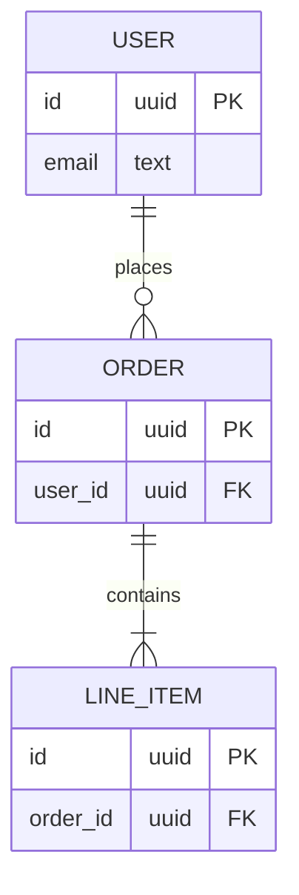

> TEMPLATE, not filled in. Do not treat as project fact.

# Data model

Copy to `docs/DATA-MODEL.md`, fill in, and delete the marker line above.

## Entities

## Notes
{{Constraints, indexes, retention, who owns each table, anything the diagram can't say.}}
